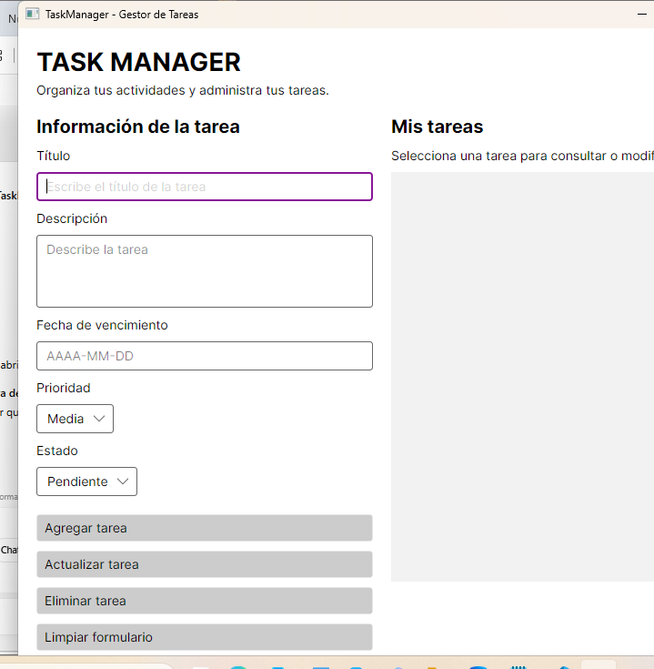
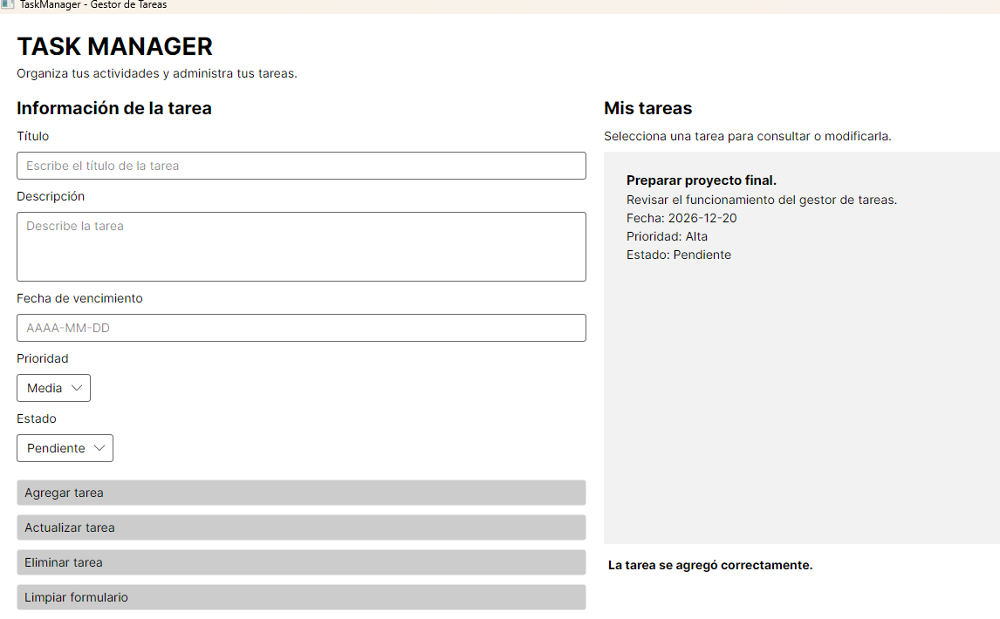
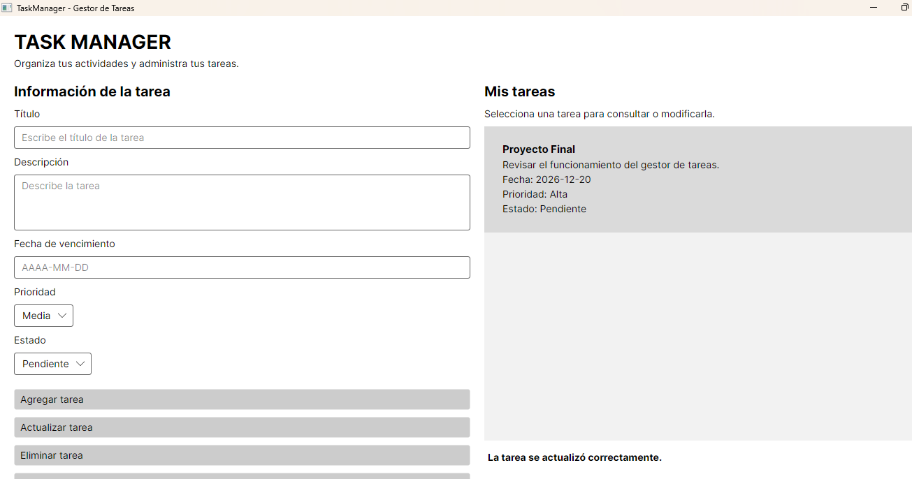
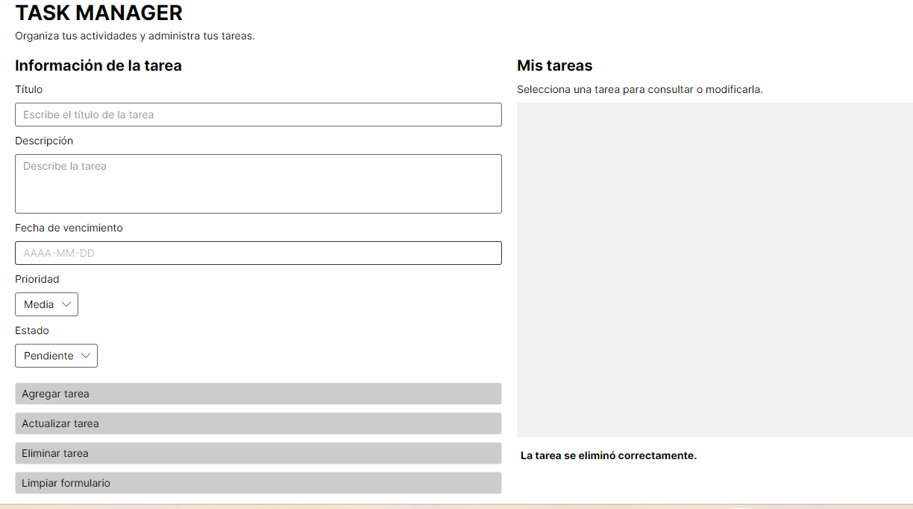
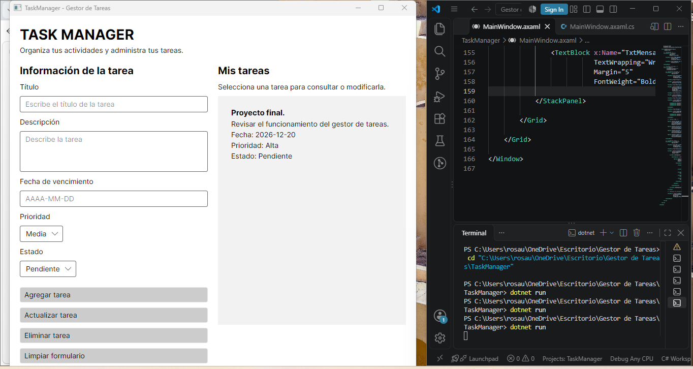
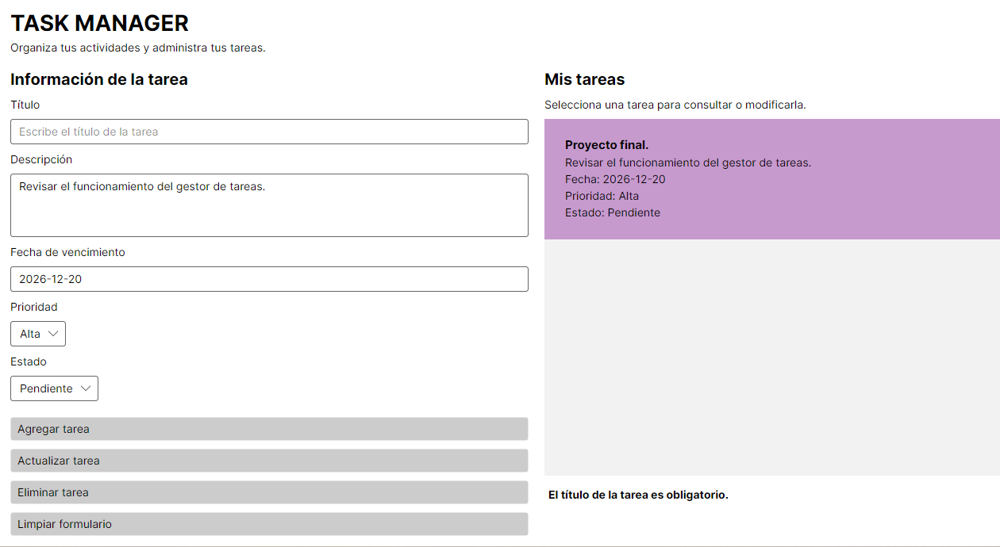

# TASK MANAGER – Gestor de Tareas

## 1. Información general del proyecto

Para el desarrollo de este proyecto realicé una aplicación de escritorio llamada **TaskManager – Gestor de Tareas**, cuyo propósito principal es facilitar la organización y administración de actividades mediante una interfaz gráfica sencilla y fácil de utilizar.

La aplicación permite registrar tareas, consultar la información almacenada, modificar los datos de una tarea existente y eliminar aquellas que ya no sean necesarias. Además, permite establecer una fecha de vencimiento, asignar un nivel de prioridad y seleccionar el estado de cada actividad.

Desarrollé este proyecto con el propósito de poner en práctica los conocimientos adquiridos durante el curso de Desarrollo de Software con .NET, especialmente en programación orientada a objetos, diseño de interfaces gráficas, conexión con bases de datos y operaciones CRUD.

## 2. Objetivo del proyecto

El objetivo principal es desarrollar una aplicación funcional que permita administrar tareas de manera organizada, utilizando herramientas de programación que faciliten la separación del código, el almacenamiento de información y la interacción con el usuario.

Con este proyecto busqué integrar los conceptos de programación orientada a objetos con una interfaz gráfica y una base de datos SQLite, logrando que la información registrada permanezca almacenada incluso después de cerrar y volver a ejecutar la aplicación.

## 3. Funcionalidades de la aplicación

La aplicación cuenta con las siguientes funcionalidades:

- **Agregar tareas:** permite registrar nuevas actividades mediante un formulario.
- **Consultar tareas:** muestra las tareas registradas en la aplicación.
- **Actualizar tareas:** permite seleccionar una tarea y modificar su información.
- **Eliminar tareas:** permite borrar las tareas que ya no se necesitan.
- **Asignar prioridad:** permite clasificar las tareas en prioridad baja, media o alta.
- **Administrar estados:** permite establecer si una tarea está pendiente o completada.
- **Validar información:** comprueba que los campos obligatorios tengan información antes de registrar o actualizar una tarea.
- **Guardar información:** utiliza SQLite para conservar los registros después de cerrar la aplicación.

## 4. Tecnologías utilizadas

Para desarrollar este proyecto utilicé las siguientes tecnologías y herramientas:

- **C#:** lenguaje de programación utilizado para desarrollar la lógica de la aplicación.
- **.NET 8:** plataforma utilizada para compilar y ejecutar el proyecto.
- **Avalonia UI:** framework utilizado para construir la interfaz gráfica mediante archivos XAML.
- **SQLite:** sistema de base de datos utilizado para almacenar la información de las tareas.
- **Microsoft.Data.Sqlite:** proveedor utilizado para establecer la conexión y ejecutar operaciones sobre la base de datos.
- **Visual Studio Code:** editor utilizado para escribir, organizar y revisar el código fuente.

## 5. Estructura del proyecto

Organicé el proyecto en diferentes carpetas y archivos para mantener el código ordenado y facilitar su comprensión.

```text
TaskManager/
│
├── Data/
│   ├── ConexionBD.cs
│   └── TareaDAO.cs
│
├── Models/
│   └── Tarea.cs
│
├── Services/
│   └── TareaServicio.cs
│
├── evidencias/
│   ├── 01_ventana_principal.png
│   ├── 02_agregar_tarea.png
│   ├── 03_actualizar_tarea.png
│   ├── 04_eliminar_tarea.png
│   ├── 05_persistencia_sqlite.png
│   └── 06_validacion.png
│
├── App.axaml
├── App.axaml.cs
├── MainWindow.axaml
├── MainWindow.axaml.cs
├── Program.cs
├── TaskManager.csproj
├── README.md
└── .gitignore
```

### Descripción de los archivos principales

- **Models/Tarea.cs:** contiene la clase Tarea, donde definí los atributos y propiedades que representan la información de cada actividad.
- **Data/ConexionBD.cs:** se encarga de establecer la conexión con SQLite y crear la tabla Tareas cuando la base de datos se inicializa.
- **Data/TareaDAO.cs:** contiene las operaciones necesarias para insertar, consultar, actualizar y eliminar registros de la base de datos.
- **Services/TareaServicio.cs:** contiene la lógica del sistema y las validaciones necesarias antes de realizar las operaciones.
- **MainWindow.axaml:** contiene el diseño visual de la aplicación, incluyendo los campos de texto, listas, botones y demás controles.
- **MainWindow.axaml.cs:** contiene el código que controla los eventos de la interfaz y comunica las acciones del usuario con los servicios.
- **App.axaml y App.axaml.cs:** contienen la configuración general de la aplicación.
- **Program.cs:** contiene el punto de entrada que permite iniciar la aplicación.
- **TaskManager.csproj:** contiene la configuración del proyecto y las dependencias utilizadas.

## 6. Aplicación de la programación orientada a objetos

Durante el desarrollo apliqué los principios de programación orientada a objetos para organizar el código y separar las responsabilidades de cada clase.

La clase principal del modelo es **Tarea**, en la cual definí los siguientes atributos:

- **Id:** identificador de cada tarea.
- **Titulo:** nombre de la actividad.
- **Descripcion:** información adicional sobre la tarea.
- **FechaVencimiento:** fecha establecida para realizar la actividad.
- **Prioridad:** nivel de importancia de la tarea.
- **Estado:** indica si la tarea está pendiente o completada.

También utilicé un constructor para inicializar los datos de cada tarea y propiedades para acceder y modificar su información.

La separación entre las carpetas Models, Data y Services permite que cada parte del programa tenga una responsabilidad específica. De esta manera, el código resulta más organizado, comprensible y fácil de mantener.

## 7. Base de datos SQLite y operaciones CRUD

Para almacenar la información utilicé SQLite, una base de datos que permite conservar los registros localmente sin necesidad de configurar un servidor externo.

La base de datos utiliza una tabla llamada **Tareas**, que contiene los campos necesarios para almacenar la información de cada actividad.

La aplicación realiza las cuatro operaciones principales conocidas como CRUD:

1. **Create (Crear):** registra una nueva tarea en la base de datos.
2. **Read (Leer):** consulta y muestra las tareas almacenadas.
3. **Update (Actualizar):** modifica la información de una tarea existente.
4. **Delete (Eliminar):** elimina una tarea seleccionada.

Para ejecutar estas operaciones utilicé comandos SQL parametrizados mediante Microsoft.Data.Sqlite. Esto permite enviar los valores de cada registro como parámetros y evita construir las consultas concatenando directamente los datos ingresados.

La base de datos se inicializa al iniciar la aplicación y la tabla se crea si todavía no existe. De esta manera, los registros permanecen guardados y pueden consultarse nuevamente al abrir el programa.

## 8. Instalación y ejecución

Para ejecutar el proyecto es necesario contar con el SDK de .NET 8 y disponer de los archivos del proyecto.

Los pasos para ejecutar la aplicación son:

1. Abrir la carpeta del proyecto en Visual Studio Code.
2. Abrir una terminal dentro de la carpeta donde se encuentra `TaskManager.csproj`.
3. Ejecutar el siguiente comando para restaurar las dependencias:

```powershell
dotnet restore
```

4. Compilar el proyecto:

```powershell
dotnet build
```

5. Ejecutar la aplicación:

```powershell
dotnet run
```

Al iniciar, se abrirá la ventana del gestor de tareas, desde donde se podrán utilizar las funcionalidades disponibles.

## 9. Pruebas realizadas y evidencias

Durante las pruebas comprobé el funcionamiento de las principales características de la aplicación. Realicé registros de tareas, modificaciones, eliminaciones y validaciones de los campos obligatorios.

También comprobé la persistencia de los datos: registré una tarea, cerré la aplicación y la ejecuté nuevamente para verificar que la información continuara almacenada en SQLite.

A continuación, presento las evidencias correspondientes a las pruebas realizadas:

### 9.1. Ventana principal



### 9.2. Registro de una tarea



### 9.3. Actualización de una tarea



### 9.4. Eliminación de una tarea



### 9.5. Persistencia de la información en SQLite



### 9.6. Validación de los campos obligatorios



## 10. Dificultades encontradas y soluciones

Durante el desarrollo se presentaron algunas dificultades relacionadas con la configuración del proyecto, la organización de las clases y la conexión entre los diferentes componentes de la aplicación.

Una de las dificultades fue adaptar la configuración inicial del proyecto para trabajar con .NET 8. También fue necesario corregir referencias entre clases y ajustar el diseño XAML para que la lista de tareas pudiera mostrar correctamente sus propiedades.

Otra parte importante fue implementar la conexión con SQLite y asegurar que las operaciones de registro, consulta, actualización y eliminación funcionaran correctamente.

Estas situaciones me permitieron comprender mejor cómo se relacionan las diferentes partes de una aplicación y la importancia de revisar los errores durante el proceso de desarrollo.

## 11. Conclusión

Con el desarrollo de TaskManager pude aplicar los conocimientos adquiridos durante el curso, integrando programación en C#, programación orientada a objetos, diseño de interfaces con Avalonia UI y almacenamiento de información mediante SQLite.

El proyecto me permitió comprender la importancia de organizar el código en diferentes clases y separar la interfaz gráfica de la lógica del sistema y del acceso a los datos.

Finalmente, logré desarrollar una aplicación de escritorio funcional que permite administrar tareas mediante operaciones CRUD, validar la información ingresada y conservar los registros después de cerrar el programa. Considero que este trabajo representa una oportunidad para fortalecer mis conocimientos y poner en práctica los conceptos fundamentales del desarrollo de software con .NET.